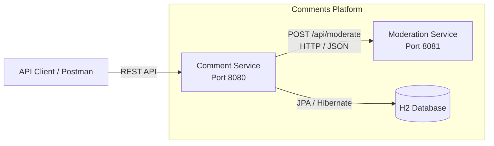
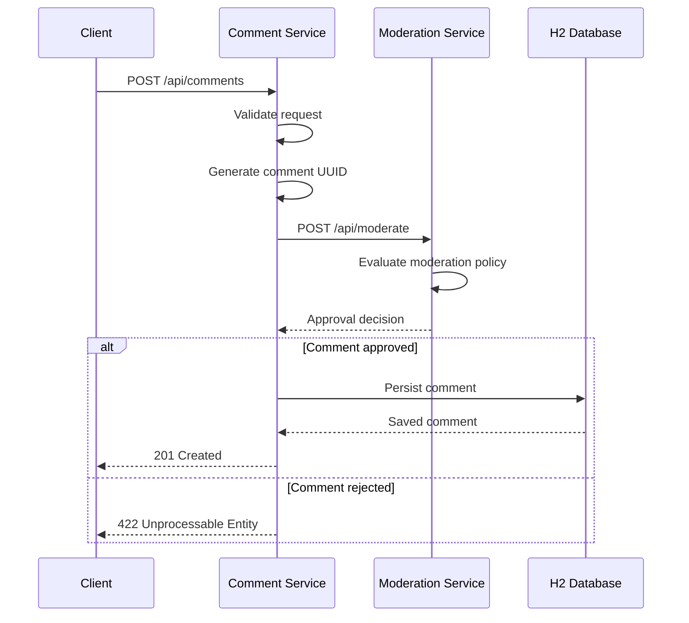

# Comments Platform

A microservices-based application for creating, moderating, and retrieving comments through independent REST services.

The platform consists of two independently executable Spring Boot applications that communicate synchronously over HTTP.

## Overview

The system separates comment management from content moderation:

- **Comment Service:** exposes the public comment API, validates requests, coordinates moderation, persists approved comments, and provides comment retrieval and pagination.
- **Moderation Service:** evaluates comment content against a deterministic, rule-based domain policy and returns an approval or rejection decision.

A comment is persisted only after it has been approved by the Moderation Service.

## Architecture



### Comment creation flow



## Technology Stack

| Technology | Purpose |
|---|---|
| Java 21 | Programming language |
| Spring Boot 4.1.2 | Application framework |
| Spring Web MVC | REST API implementation |
| Spring RestClient | Synchronous HTTP communication |
| Spring Data JPA | Persistence abstraction |
| Hibernate | ORM implementation |
| H2 Database | In-memory relational database |
| Jakarta Validation | Request validation |
| Maven | Build and dependency management |
| JUnit 5 | Automated testing |
| Mockito | Mocking and unit testing |
| MockMvc | REST controller testing |
| MockRestServiceServer | HTTP client testing |

## Project Structure

```text
comments-platform/
├── comment-service/
│   └── src/
│       ├── main/
│       │   └── java/com/rochacamargovitor/comments/
│       │       ├── api/
│       │       │   ├── controller/
│       │       │   ├── dto/
│       │       │   └── exception/
│       │       ├── application/
│       │       │   ├── exception/
│       │       │   └── service/
│       │       ├── domain/
│       │       │   └── model/
│       │       └── infrastructure/
│       │           ├── client/
│       │           │   └── dto/
│       │           ├── config/
│       │           └── persistence/
│       │               ├── entity/
│       │               └── repository/
│       └── test/
│           └── java/com/rochacamargovitor/comments/
│               ├── api/
│               │   └── controller/
│               ├── application/
│               │   └── service/
│               ├── domain/
│               │   └── model/
│               └── infrastructure/
│                   ├── client/
│                   └── persistence/
│                       └── repository/
│
├── moderation-service/
│   └── src/
│       ├── main/
│       │   └── java/com/rochacamargovitor/moderation/
│       │       ├── api/
│       │       │   ├── controller/
│       │       │   └── dto/
│       │       ├── application/
│       │       │   └── service/
│       │       ├── domain/
│       │       │   └── model/
│       │       └── infrastructure/
│       │           └── config/
│       └── test/
│           └── java/com/rochacamargovitor/moderation/
│               ├── api/
│               │   └── controller/
│               ├── application/
│               │   └── service/
│               └── domain/
│                   └── model/
│
├── .gitignore
└── README.md
```

### Package Responsibilities

| Package | Responsibility |
|---|---|
| `api` | Exposes the HTTP API, handles requests, responses, DTOs, and API-level exceptions. |
| `application` | Coordinates application use cases and application-level exceptions. |
| `domain` | Contains core business concepts, rules, and domain models. |
| `infrastructure` | Implements technical integrations, persistence, configuration, and external HTTP communication. |

The `comment-service` contains persistence and an HTTP client for communicating with the `moderation-service`. The `moderation-service` contains the moderation policy and its API, without requiring its own database.

## Prerequisites

- Java 21
- Maven Wrapper (included in each service)
- Git

No external database installation is required for the current implementation.

## Running the Application

Both services must be running for the complete comment creation workflow.

### 1. Start the Moderation Service

Open a terminal:

```bash
cd moderation-service
./mvnw spring-boot:run
```

The service will be available at:

```text
http://localhost:8081
```

### 2. Start the Comment Service

Open another terminal from the repository root:

```bash
cd comment-service
./mvnw spring-boot:run
```

The service will be available at:

```text
http://localhost:8080
```

The Comment Service communicates with the Moderation Service using the following configuration:

```properties
moderation.service.base-url=http://localhost:8081
```

The HTTP client is configured with a five-second read timeout.

## API Reference

### Comment Service

Base URL:

```text
http://localhost:8080
```

| Method | Endpoint | Description |
|---|---|---|
| POST | `/api/comments` | Create a comment |
| GET | `/api/comments/{id}` | Retrieve a comment by UUID |
| GET | `/api/comments` | Retrieve comments with pagination |

#### Create a comment

**Request**

```http
POST /api/comments
Content-Type: application/json
```

```json
{
  "text": "This is a great platform!",
  "author": "John"
}
```

**Successful response — 201 Created**

```json
{
  "id": "00000000-0000-0000-0000-000000000001",
  "text": "This is a great platform!",
  "author": "John",
  "createdAt": "2026-11-13T15:00:00Z"
}
```

The UUID and timestamp above are illustrative. The application generates a unique UUID and creation timestamp for each new comment.

#### Retrieve a comment

```http
GET /api/comments/{id}
```

Returns the requested comment when it exists.

**Response:** `200 OK`

If the comment does not exist, the API returns `404 Not Found`.

#### List comments

```http
GET /api/comments?page=0&size=10
```

Pagination parameters:

| Parameter | Default | Description |
|---|---:|---|
| page | 0 | Zero-based page index |
| size | 10 | Number of records per page (maximum 100) |

Results are sorted by creation date in descending order, displaying the newest comments first.

**Example response**

```json
{
  "page": 0,
  "size": 10,
  "totalElements": 1,
  "totalPages": 1,
  "content": [
    {
      "id": "00000000-0000-0000-0000-000000000001",
      "text": "This is a great platform!",
      "author": "John",
      "createdAt": "2026-11-13T15:00:00Z"
    }
  ]
}
```

### Moderation Service

Base URL:

```text
http://localhost:8081
```

| Method | Endpoint | Description |
|---|---|---|
| POST | `/api/moderate` | Evaluate comment content |

#### Moderate a comment

**Request**

```http
POST /api/moderate
Content-Type: application/json
```

```json
{
  "commentId": "00000000-0000-0000-0000-000000000001",
  "text": "This is a great platform!"
}
```

**Approved response — 200 OK**

```json
{
  "approved": true,
  "reason": null
}
```

**Rejected response — 200 OK**

```json
{
  "approved": false,
  "reason": "The comment contains prohibited language."
}
```

A rejection is a business decision, not an HTTP communication failure. Therefore, both approval and rejection return `200 OK` from the Moderation Service.

## Moderation Policy

The initial moderation policy checks for the following prohibited words:

- `hate`
- `idiot`
- `stupid`
- `offensive`
- `insult`

The comparison is case-insensitive and checks complete words rather than arbitrary substrings.

This implementation is intentionally deterministic and rule-based. It does not perform semantic analysis, stemming, or machine-learning classification.

## Error Handling

The Comment Service exposes consistent error responses:

```json
{
  "reason": "Error description"
}
```

| HTTP Status | Meaning |
|---|---|
| 400 | Invalid request or pagination parameters |
| 404 | Comment not found |
| 422 | Comment rejected by moderation |
| 502 | Moderation Service communication failure |
| 504 | Moderation Service request timeout |

The Moderation Service uses HTTP `200 OK` for both approved and rejected moderation decisions.

## Database

The Comment Service currently uses an H2 in-memory database.

Configuration:

```properties
spring.datasource.url=jdbc:h2:mem:commentsdb
spring.datasource.username=sa
spring.datasource.password=
```

The H2 console is available at:

```text
http://localhost:8080/h2-console
```

Connection settings:

- JDBC URL: `jdbc:h2:mem:commentsdb`
- Username: `sa`
- Password: leave empty

**Important:** The database is in-memory. Data is not preserved after the application process terminates.

## Running Tests

Each microservice has its own independent test suite.

### Comment Service

```bash
cd comment-service
./mvnw clean test
```

### Moderation Service

```bash
cd moderation-service
./mvnw clean test
```

The test suites cover domain behavior, application services, persistence, REST controllers, HTTP client communication, request validation, and error handling.

## Architectural Approach

The project uses a layered architecture with clear separation of responsibilities and concepts inspired by Clean Architecture.

The main layers are:

- **API:** HTTP controllers, request/response DTOs, and exception handling.
- **Application:** application services and use-case orchestration.
- **Domain:** business models and moderation policies.
- **Infrastructure:** persistence, HTTP clients, and framework-specific configuration.

The implementation favors explicit responsibilities, constructor-based dependency injection, independent service contracts, and testable business logic.

It is a pragmatic architecture inspired by Clean Architecture principles, not a strict implementation of every Clean Architecture boundary.

A detailed architectural document will cover the design principles, patterns, trade-offs, and implementation decisions.

## Future Improvements

Potential improvements include:

- Dockerfiles and Docker Compose for independent containerization.
- Automated CI pipelines using GitHub Actions.
- Persistent database configuration for production environments.
- Centralized observability and distributed tracing.
- Correlation IDs across service requests.
- Circuit breaker and retry strategies.
- API documentation using OpenAPI.
- Authentication and authorization.
- Deployment automation.

These are planned improvements and are not part of the current implementation.

## License

This project is intended for educational and portfolio purposes. Add an explicit license before permitting reuse or redistribution.