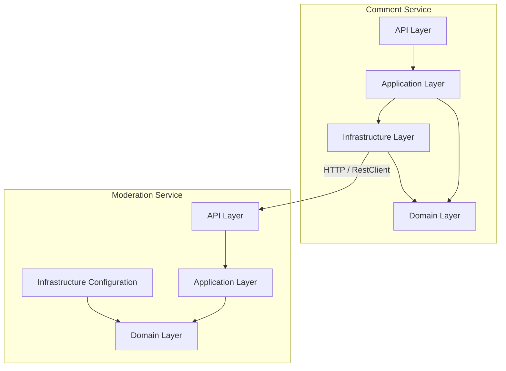
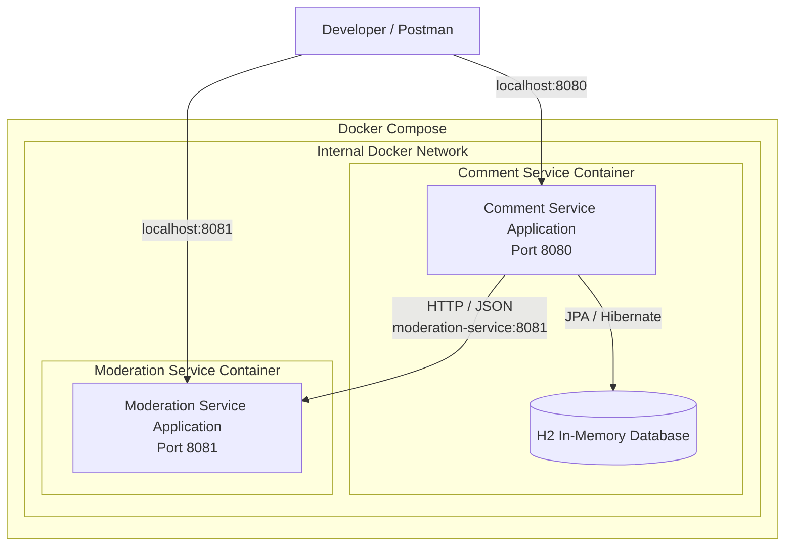

# Comments Platform — Architecture & Engineering Guide

## 1. Introduction

This document describes the architectural foundations, engineering principles, design patterns, implementation decisions, and technical trade-offs behind the Comments Platform.

The purpose is not only to document the existing implementation but also to establish a comprehensive learning reference for understanding the software engineering concepts applied throughout the project.

The platform consists of two independently executable Spring Boot microservices:

- **Comment Service:** manages comment creation, moderation orchestration, persistence, retrieval, and pagination.
- **Moderation Service:** evaluates comment content against a deterministic business policy.

The architecture follows a pragmatic layered approach inspired by Clean Architecture, Domain-Driven Design, and established software engineering principles.

This document distinguishes between:

- Concepts implemented in the current system.
- Architectural principles that influenced implementation decisions.
- Potential improvements for a production-oriented evolution.

---

# Part I — Software Engineering Foundations

## 2. Software Engineering Fundamentals

Software engineering is the discipline of designing, building, testing, operating, and maintaining software systems through systematic engineering practices.

Writing code that works is only one part of software engineering.

A maintainable system must also address:

- Readability.
- Modularity.
- Testability.
- Extensibility.
- Reliability.
- Security.
- Performance.
- Operational complexity.

### 2.1 Abstraction

Abstraction means exposing essential characteristics while hiding unnecessary implementation details.

An abstraction allows a developer to interact with a component without needing to understand all its internal mechanisms.

**Example from the project:**

The `CommentRepository` exposes persistence operations through Spring Data JPA:

```java
public interface CommentRepository
        extends JpaRepository<CommentEntity, UUID> {
}
```

The application can invoke:

```java
commentRepository.save(entity);
```

without manually implementing SQL statements, connection management, or database interaction.

Spring Data JPA provides the implementation at runtime.

**Why it matters:**

Abstraction reduces the amount of implementation detail that consumers must understand.

### 2.2 Encapsulation

Encapsulation protects an object's internal state and controls how that state can be accessed or modified.

The `Comment` domain model demonstrates encapsulation:

```java
public final class Comment {

    private final UUID id;
    private final String text;
    private final String author;
    private final Instant createdAt;
}
```

Its attributes are private and immutable.

The constructor validates the object's initial state, preventing invalid instances from being created through the public constructor.

**Why it matters:**

Encapsulation helps maintain invariants and prevents uncontrolled modification of business data.

### 2.3 Modularity

Modularity means organizing software into components with well-defined responsibilities.

The platform separates:

- API concerns.
- Application orchestration.
- Domain rules.
- Infrastructure implementations.

Each microservice also has its own Maven project.

This allows each service to be built and executed independently.

**Why it matters:**

A modular system is easier to understand, test, modify, and evolve.

### 2.4 Separation of Concerns

Separation of Concerns (SoC) means assigning different responsibilities to different parts of the system.

For example:

- Controllers handle HTTP requests and responses.
- Application services coordinate use cases.
- Domain models represent business concepts.
- Repositories handle persistence.
- HTTP clients handle communication with external services.

A controller should not implement database queries or moderation rules directly.

**Why it matters:**

Changes to one concern should have minimal impact on unrelated concerns.

### 2.5 Coupling and Cohesion

**Coupling** measures how strongly components depend on each other.

**Cohesion** describes how closely related the responsibilities within a component are.

A desirable design generally favors:

- Low coupling between components.
- High cohesion within components.

For example, `ModerationPolicy` has high cohesion because its responsibility is evaluating moderation rules.

The `ModerationClient` encapsulates the technical details of communicating with the Moderation Service.

These responsibilities should not be mixed.

### 2.6 Accidental and Essential Complexity

Essential complexity comes from the actual problem being solved.

Accidental complexity comes from implementation decisions, unnecessary abstractions, or technological complications.

In this project:

- Moderating a comment is essential complexity.
- Persisting approved comments is essential complexity.
- Creating unnecessary interfaces for every class would introduce accidental complexity.

Good engineering does not mean introducing the largest possible number of patterns or abstractions.

It means selecting the simplest design that adequately addresses the problem.

---

# Part II — Software Architecture

## 3. Software Architecture

Software architecture describes the fundamental organization of a software system.

It defines:

- Components and their responsibilities.
- Relationships and dependencies.
- Communication mechanisms.
- Data ownership.
- Architectural boundaries.
- Important technical decisions.

Architecture and detailed design are related but different.

**Architecture** defines the major structural decisions.

**Design** describes how individual components fulfill their responsibilities.

For example:

- Choosing two independently executable microservices is an architectural decision.
- Choosing a Java Record for a request DTO is a design decision.

### 3.1 Layered Architecture

Layered Architecture organizes an application into logical layers.

The Comments Platform follows this general organization:

```text
API
 |
 v
Application
 |
 v
Domain

Infrastructure supports technical operations
such as persistence and external communication.
```

The layers have different responsibilities.

| Layer | Responsibility |
|---|---|
| API | HTTP communication and request/response handling |
| Application | Use-case orchestration |
| Domain | Business rules and domain models |
| Infrastructure | Database, HTTP clients, and framework integration |

This separation helps prevent business logic from becoming coupled to technical implementation details.

### 3.2 Monolithic Architecture

A monolithic application is deployed as a single application unit.

A monolith can still have excellent internal modularity.

Monolithic architecture is not inherently bad.

It can provide:

- Simpler deployment.
- Simpler local development.
- Easier transactions across modules.
- Lower operational complexity.

### 3.3 Microservices Architecture

Microservices architecture decomposes a system into independently deployable services organized around business capabilities.

Each service owns a specific responsibility and exposes a contract through which other services interact with it.

In this project:

| Service | Main responsibility |
|---|---|
| Comment Service | Comment lifecycle and persistence |
| Moderation Service | Content moderation decisions |

The services are independent applications with separate Maven projects and application configurations.

### 3.4 Modular Monolith vs. Microservices

A modular monolith separates responsibilities internally but is deployed as one application.

Microservices introduce independent runtime and deployment boundaries.

| Characteristic | Modular Monolith | Microservices |
|---|---|---|
| Deployment | Single application | Independent services |
| Runtime | Shared | Independent |
| Communication | Usually in-process | Network-based |
| Operational complexity | Lower | Higher |
| Failure isolation | Limited | Possible between services |
| Data ownership | Shared application boundary | Preferably service-owned |

Microservices introduce additional complexity:

- Network latency.
- Partial failures.
- Distributed observability.
- Data consistency challenges.
- Deployment coordination.
- Service availability dependencies.

They should be introduced when their benefits justify those costs.

---

## 4. Domain-Driven Design Fundamentals

Domain-Driven Design (DDD) is an approach to software development that emphasizes understanding and modeling the business domain.

DDD is not simply a collection of technical patterns.

It encourages developers to understand the problem being solved before deciding how to implement it.

### 4.1 Domain

The domain is the business problem area addressed by the software.

For this platform, the domain includes:

- Comments.
- Authors.
- Comment creation.
- Moderation decisions.
- Approval and rejection.

### 4.2 Subdomain

A subdomain represents a specific area of a broader business domain.

The platform separates two capabilities:

- Comment Management.
- Content Moderation.

These capabilities have different responsibilities and rules.

### 4.3 Bounded Context

A Bounded Context defines a boundary within which a particular domain model and terminology are valid.

The two services can be understood as approximating distinct Bounded Contexts because they encapsulate different responsibilities and maintain independent models and contracts.

However, the current project does not implement a comprehensive strategic Domain-Driven Design approach. The separation is primarily based on the distinct business capabilities of comment management and content moderation.

**Comment Service context:**

Understands comment identity, authorship, creation time, persistence, and retrieval.

**Moderation Service context:**

Understands moderation requests, prohibited language, and approval decisions.

Each service owns its own model and API contract.

### 4.4 Independent Models

The platform intentionally avoids sharing Java DTO classes between microservices.

For example:

```java
// Comment Service
public record ModerationRequest(
        UUID commentId,
        String text
) {
}
```

```java
// Moderation Service
public record ModerationInput(
        UUID commentId,
        String text
) {
}
```

Although these records contain similar fields, they belong to different applications.

This is intentional.

Sharing implementation classes would create a compile-time dependency between independently deployable services.

### 4.5 Ubiquitous Language

Ubiquitous Language is a shared vocabulary used by developers and domain experts within a bounded context.

Examples in this project:

- Comment.
- Moderation.
- Approval.
- Rejection.
- Prohibited Word.
- Moderation Decision.

Consistent terminology improves communication and reduces ambiguity.

---

# Part III — Clean Architecture

## 5. Clean Architecture

Clean Architecture is an architectural approach popularized by Robert C. Martin.

Its primary objective is to keep business rules independent of external technologies and implementation details.

The central principle is the Dependency Rule:

**Source code dependencies should point inward, toward higher-level policies.**

External mechanisms should depend on business rules rather than the opposite.

### 5.1 The Four Conceptual Layers

Clean Architecture is commonly represented through four conceptual layers.

#### 5.1.1 Entities

Entities represent core business concepts and rules.

They contain business behavior and invariants that should remain independent of frameworks.

Project example:

```text
comment-service/
└── domain/
    └── model/
        └── Comment.java
```

The `Comment` class is a domain model independent of JPA and Spring.

#### 5.1.2 Use Cases

Use Cases coordinate application-specific business operations.

They define how the system fulfills a particular application requirement.

Project examples:

```text
CommentService.create()
CommentService.getById()
CommentService.findAll()
ModerationService.moderate()
```

These application services coordinate domain behavior and technical operations.

#### 5.1.3 Interface Adapters

Interface Adapters translate information between external mechanisms and internal application models.

Examples:

- REST controllers.
- Request and response DTOs.
- Persistence adapters.
- HTTP client adapters.

Project examples:

```text
CommentController
ModerationController
CommentEntity
ModerationClient
```

The controllers translate HTTP requests into application method calls.

Persistence entities translate between the domain representation and the database representation.

#### 5.1.4 Frameworks and Drivers

This outer layer contains external technologies and infrastructure mechanisms.

Examples:

- Spring Boot.
- Spring MVC.
- Spring Data JPA.
- Hibernate.
- H2 Database.
- HTTP client implementation.

These technologies support the application but should not define its core business rules.

### 5.2 Dependency Rule

A dependency is a relationship in which one component needs another component to compile or execute.

Clean Architecture recommends that dependencies point inward.

For example:

```text
Infrastructure ---> Application ---> Domain
```

The domain should not depend on Spring, Hibernate, or HTTP libraries.

### 5.3 Dependency Inversion Principle

Dependency Inversion Principle (DIP) states that high-level modules should not depend directly on low-level modules.

Both should depend on abstractions.

This principle is related to, but not identical to, Dependency Injection.

- Dependency Inversion is a design principle.
- Dependency Injection is a technique for supplying dependencies.

### 5.4 Ports and Adapters

Ports and Adapters is also known as Hexagonal Architecture.

A port defines a boundary through which an application communicates with an external capability.

An adapter implements the technical interaction with that capability.

A strict implementation could introduce:

```java
public interface CommentPersistencePort {

    Comment save(Comment comment);

    Optional<Comment> findById(UUID id);
}
```

An infrastructure adapter would implement this interface using Spring Data JPA.

The application would depend on the port rather than directly on `CommentRepository`.

### 5.5 How Clean Architecture Is Applied in This Project

The project adopts several Clean Architecture principles:

- Domain models do not depend on Spring.
- Domain rules are isolated from HTTP controllers.
- API DTOs are separated from domain models.
- Persistence entities are separated from domain models.
- External HTTP communication is encapsulated in `ModerationClient`.
- Application services coordinate use cases.

However, the implementation is not a strict Clean Architecture implementation.

An important example is:

```java
private final CommentRepository commentRepository;
```

The `CommentService` directly depends on the infrastructure repository interface provided by Spring Data JPA.

A stricter implementation would introduce an application-owned persistence port and an infrastructure adapter.

This project deliberately avoids that additional abstraction at the current scale.

The decision favors simplicity while preserving clear responsibilities.

### 5.6 Clean Architecture vs. Hexagonal Architecture vs. Onion Architecture

These architectural approaches share important ideas but use different terminology and organizational models.

| Architecture | Main emphasis |
|---|---|
| Clean Architecture | Dependency Rule and concentric layers |
| Hexagonal Architecture | Ports and Adapters |
| Onion Architecture | Domain model at the center and dependencies directed inward |

All three aim to protect business logic from external implementation details.

They are related approaches, not interchangeable names for exactly the same architecture.

---

# Part IV — SOLID Principles

## 6. SOLID

SOLID is a collection of five object-oriented design principles.

The objective is to make software easier to maintain, extend, and test.

## 6.1 Single Responsibility Principle (SRP)

A class should have one primary responsibility and one coherent reason to change.

Project examples:

- `CommentController`: HTTP request and response handling.
- `CommentService`: comment application use cases.
- `ModerationClient`: HTTP communication with the Moderation Service.
- `ModerationPolicy`: moderation business rules.
- `CommentEntity`: database persistence representation.

These classes separate different reasons for change.

A controller should not implement moderation rules or persistence operations directly.

## 6.2 Open/Closed Principle (OCP)

Software entities should be open for extension but closed for modification.

The objective is to allow new behavior without constantly modifying stable existing code.

The current moderation policy uses a fixed list of prohibited words.

A future implementation could introduce different moderation strategies:

```java
public interface ModerationStrategy {

    ModerationDecision evaluate(String text);
}
```

Possible implementations could include:

- RuleBasedModerationStrategy.
- ExternalModerationStrategy.
- MachineLearningModerationStrategy.

This would allow alternative policies to be introduced without placing all logic inside one large class.

This extension mechanism is a possible future improvement, not part of the current implementation.

## 6.3 Liskov Substitution Principle (LSP)

Objects of a subtype should be usable wherever objects of the parent type are expected without breaking expected behavior.

The principle is concerned with behavioral compatibility.

Inheritance should not be used simply to reuse code.

In this project, the exception hierarchy demonstrates polymorphic exception handling:

```text
RuntimeException
       |
       v
ModerationServiceException
       |
       v
ModerationTimeoutException
```

A timeout exception can be caught and handled as a general moderation service communication exception.

This demonstrates a practical use of subtype polymorphism, but it should not be considered sufficient evidence of full Liskov Substitution Principle compliance. LSP requires behavioral substitutability, not merely inheritance.

## 6.4 Interface Segregation Principle (ISP)

Clients should not be forced to depend on methods they do not use.

Interfaces should expose cohesive and focused contracts.

For example, a future persistence abstraction should expose only the operations required by the application.

It should not expose every possible database operation if the application only needs a small subset.

The current project uses Spring Data JPA's `JpaRepository`, which provides a broader contract than the application strictly requires.

A dedicated application-owned persistence port could provide a narrower interface.

## 6.5 Dependency Inversion Principle (DIP)

High-level business policies should not depend directly on low-level implementation details.

The domain layer follows this principle by remaining independent of Spring and persistence frameworks.

However, `CommentService` currently depends directly on `CommentRepository`, which belongs to the infrastructure layer.

This is a conscious simplification and a known deviation from strict DIP application at that boundary.

### 6.6 SOLID Summary

| Principle | Project application |
|---|---|
| SRP | Separate controllers, services, clients, policies, and persistence entities |
| OCP | Moderation strategy extension is a potential evolution |
| LSP | Exception hierarchy supports substitutability |
| ISP | Narrower persistence contracts could improve the design |
| DIP | Domain independence is preserved; persistence dependency remains pragmatic |

SOLID principles are design guidelines, not a checklist requiring one interface per class.

---

# Part V — Design Patterns

## 7. Design Patterns

Design patterns are reusable solutions to recurring software design problems.

They describe approaches rather than ready-made implementations.

## 7.1 Dependency Injection

Dependency Injection is a technique in which an object's dependencies are provided externally instead of being instantiated internally.

Project example:

```java
@Service
public class CommentService {

    private final CommentRepository commentRepository;
    private final ModerationClient moderationClient;

    public CommentService(
            CommentRepository commentRepository,
            ModerationClient moderationClient
    ) {
        this.commentRepository = Objects.requireNonNull(commentRepository);
        this.moderationClient = Objects.requireNonNull(moderationClient);
    }
}
```

Spring creates the dependencies and injects them through the constructor.

Benefits:

- Lower coupling.
- Easier testing.
- Explicit dependencies.
- Better separation of responsibilities.

Constructor injection is preferred because it makes required dependencies explicit.

## 7.2 Repository Pattern

The Repository Pattern provides an abstraction for accessing persisted objects.

Project example:

```java
public interface CommentRepository
        extends JpaRepository<CommentEntity, UUID> {
}
```

Spring Data JPA generates the implementation at runtime.

Benefits:

- Centralized persistence operations.
- Less boilerplate.
- Separation between application logic and SQL details.

The current implementation uses Spring Data JPA directly rather than an application-owned repository port.

## 7.3 Data Transfer Object (DTO)

A DTO is an object designed to transfer data between boundaries.

DTOs should represent communication contracts rather than internal domain behavior.

Project examples:

```java
public record CommentInput(
        @NotBlank String text,
        @NotBlank String author
) {
}
```

```java
public record CommentOutput(
        UUID id,
        String text,
        String author,
        Instant createdAt
) {
}
```

DTOs prevent external API contracts from becoming tightly coupled to internal domain models or database entities.

Java Records are useful for DTOs because they provide concise immutable data carriers.

## 7.4 Adapter Pattern

The Adapter Pattern translates one interface into another expected by a consumer.

`ModerationClient` acts as an integration adapter.

It translates the Comment Service's internal request into an HTTP request and converts the HTTP response into an internal response DTO.

```text
CommentService
      |
      v
ModerationClient
      |
      v
HTTP / JSON
      |
      v
Moderation Service
```

This isolates the application from HTTP communication details.

## 7.5 Strategy Pattern

The Strategy Pattern allows different algorithms or policies to be selected through a common contract.

The current `ModerationPolicy` implements one deterministic moderation algorithm.

The current implementation does not use multiple interchangeable strategies.

Introducing a `ModerationStrategy` interface could become useful if different moderation mechanisms are required.

## 7.6 Exception Translation

Exception Translation converts low-level technical failures into meaningful application-level exceptions.

The `ModerationClient` translates communication errors into:

- `ModerationTimeoutException`.
- `ModerationServiceException`.

The global exception handler then maps these exceptions to HTTP responses.

This prevents low-level HTTP client exceptions from leaking directly into the public API.

## 7.7 Additional Patterns for Future Evolution

| Pattern | Purpose | Potential application |
|---|---|---|
| Factory | Centralize object creation | Complex moderation strategy creation |
| Observer | Notify interested components | Asynchronous moderation notifications |
| Decorator | Add behavior without modifying the original object | Client metrics and logging |
| Circuit Breaker | Stop repeated calls to failing dependencies | Moderation Service resilience |
| Retry | Retry transient failures | Temporary network failures |
| Bulkhead | Isolate resource consumption | Protect request processing capacity |
| Saga | Coordinate distributed business transactions | Future workflows involving multiple services |

These patterns are not currently implemented unless explicitly described elsewhere in this document.

---

# Part VI — Spring Boot and Framework Concepts

## 8. Spring Boot Fundamentals

Spring Boot simplifies application development by providing conventions, auto-configuration, and an integrated application runtime.

It is built on top of the Spring Framework.

### 8.1 Inversion of Control (IoC)

Inversion of Control means that object creation and lifecycle management are delegated to a framework or container.

Without IoC, application code might instantiate its own dependencies:

```java
CommentRepository repository = new SomeRepositoryImplementation();
```

With Spring IoC, the framework manages registered components and their dependencies.

### 8.2 Spring Application Context

The Application Context is Spring's container responsible for managing application beans.

It handles:

- Bean creation.
- Dependency injection.
- Bean lifecycle.
- Configuration.
- Component discovery.

### 8.3 Beans

A Bean is an object managed by the Spring container.

Examples in this project include:

- `CommentService`.
- `ModerationClient`.
- `ModerationPolicy`.
- `RestClient`.

### 8.4 Component Scanning

Spring scans configured packages to discover components annotated with stereotypes such as:

- `@Component`.
- `@Service`.
- `@Repository`.
- `@Controller`.
- `@RestController`.
- `@Configuration`.

This enables automatic registration of components.

### 8.5 Configuration and @Bean

`@Configuration` marks a class as a source of Spring bean definitions.

Example:

```java
@Configuration
public class ModerationConfiguration {

    @Bean
    public ModerationPolicy moderationPolicy() {
        return new ModerationPolicy();
    }
}
```

The moderation policy remains a plain Java class.

Spring manages its lifecycle through the configuration method.

This approach allows domain classes to remain independent of Spring annotations.

### 8.6 Spring Data JPA

Spring Data JPA reduces the amount of persistence code required by applications.

It provides repository abstractions that integrate with JPA providers.

The project uses `JpaRepository` for:

- Saving comments.
- Finding comments by UUID.
- Retrieving paginated results.

### 8.7 Hibernate

Hibernate is an Object-Relational Mapping (ORM) implementation.

It maps Java objects to relational database structures.

Spring Data JPA provides repository abstractions, while Hibernate performs the ORM operations in this application.

### 8.8 Spring RestClient

`RestClient` is Spring's synchronous HTTP client.

The Comment Service uses it to communicate with the Moderation Service.

Example:

```java
return restClient.post()
        .uri("/api/moderate")
        .contentType(MediaType.APPLICATION_JSON)
        .body(request)
        .retrieve()
        .body(ModerationResponse.class);
```

The request and response are represented by Java objects and serialized or deserialized as JSON.

### 8.9 Jakarta Validation

Jakarta Validation provides declarative validation constraints.

Example:

```java
public record CommentInput(
        @NotBlank String text,
        @NotBlank String author
) {
}
```

The controller uses `@Valid` to trigger validation of the request body.

Invalid requests are rejected before reaching the application service.

---

# Part VII — Microservices Architecture and Distributed Systems

## 9. Microservices Architecture

A microservice is an independently executable service responsible for a focused business capability.

A microservice architecture is not simply an application divided into multiple projects.

It requires meaningful boundaries and independent operational responsibilities.

### 9.1 Service Autonomy

Service autonomy means that a service can evolve and be deployed independently within its defined responsibilities.

The two platform services have:

- Independent Spring Boot applications.
- Separate Maven projects.
- Separate application configurations.
- Independent HTTP contracts.
- Different responsibilities.

The Comment Service depends on the Moderation Service at runtime for comment creation, but the applications can be built and executed independently.

### 9.2 Database per Service

Database per Service is an architectural principle in which each microservice owns its data.

The Comment Service owns comment persistence.

The Moderation Service does not require a database in the current implementation because its policy is stateless and rule-based.

The objective is to prevent services from directly sharing internal persistence structures.

### 9.3 Synchronous Communication

The services communicate synchronously using HTTP REST.

The interaction follows this sequence:

1. A client submits a comment.
2. The Comment Service validates the request.
3. The Comment Service generates a UUID.
4. The Comment Service sends a moderation request.
5. The Moderation Service evaluates the content.
6. The Comment Service receives the decision.
7. The comment is persisted only if approved.
8. The client receives the result.

The synchronous model is simple and appropriate for the current requirements.

However, the Comment Service must wait for the Moderation Service response.

### 9.4 Synchronous vs. Asynchronous Communication

| Characteristic | Synchronous | Asynchronous |
|---|---|---|
| Response | Immediate | Usually delayed |
| Coupling | Temporal coupling | Lower temporal coupling |
| Complexity | Simpler initial implementation | More infrastructure and coordination |
| Failure handling | Request failure or timeout | Retries, queues, delivery guarantees |
| User experience | Immediate result | Often eventual result |

An asynchronous implementation could use a message broker such as RabbitMQ or Kafka.

That would introduce new concerns:

- Message delivery.
- Duplicate processing.
- Idempotency.
- Eventual consistency.
- Dead-letter queues.
- Event versioning.

### 9.5 API Contracts

An API contract defines how services communicate.

The Moderation Service expects:

```json
{
  "commentId": "00000000-0000-0000-0000-000000000001",
  "text": "Example comment"
}
```

It responds with:

```json
{
  "approved": true,
  "reason": null
}
```

Each service maintains its own DTOs.

This prevents a shared Java model from becoming a compile-time coupling mechanism.

### 9.6 Service Discovery

Service Discovery allows applications to locate other services dynamically.

The current implementation uses a configured base URL:

```properties
moderation.service.base-url=http://localhost:8081
```

This is sufficient for local development.

In a larger environment, service discovery could be provided by:

- Kubernetes DNS.
- Cloud service discovery.
- Dedicated service registry solutions.

### 9.7 API Gateway

An API Gateway is an entry point that routes external requests to internal services.

Potential responsibilities include:

- Routing.
- Authentication.
- Authorization.
- Rate limiting.
- Request transformation.
- Centralized access policies.

The current platform does not include an API Gateway.

The Comment Service is the public entry point for the comment workflow.

---

# Part VIII — Persistence and Data Modeling

## 10. Domain Models and Persistence Entities

The platform separates business representations from persistence representations.

### 10.1 Domain Model

A domain model represents a business concept independently of database implementation.

Example:

```java
public final class Comment {

    private final UUID id;
    private final String text;
    private final String author;
    private final Instant createdAt;
}
```

It does not contain JPA annotations.

### 10.2 Persistence Entity

A persistence entity represents how information is stored through an ORM.

Example:

```java
@Entity
@Table(name = "comments")
public class CommentEntity {

    @Id
    private UUID id;

    @Column(nullable = false)
    private String author;
}
```

It contains persistence-specific annotations.

### 10.3 Why Separate Domain Models and Entities?

Combining domain models and JPA entities can be convenient in small applications.

However, separating them provides:

- Independent business modeling.
- Reduced framework coupling.
- Explicit persistence mapping.
- Better control over database representation.
- More flexibility when persistence technology changes.

The trade-off is additional mapping code.

The project chooses separation to demonstrate and preserve these boundaries.

### 10.4 UUID

UUID stands for Universally Unique Identifier.

The platform generates comment identifiers using:

```java
UUID.randomUUID()
```

The same UUID is sent to the Moderation Service and used when the approved comment is persisted.

This creates a stable identifier across the request workflow.

### 10.5 Instant and UTC

`Instant` represents a point on the global timeline.

The platform uses:

```java
Instant.now()
```

This avoids relying on a machine's local timezone when recording creation timestamps.

JSON serialization produces an ISO-8601 timestamp.

### 10.6 Object-Relational Mapping

ORM maps object-oriented structures to relational database tables.

For example:

```text
CommentEntity
      |
      v
comments table
```

Hibernate handles the mapping and database operations.

### 10.7 Pagination

Pagination divides large result sets into smaller portions.

The Comment Service uses Spring Data's `Pageable` abstraction.

Example:

```java
PageRequest.of(
        page,
        size,
        Sort.by(Sort.Direction.DESC, "createdAt")
);
```

The result includes:

- Page number.
- Page size.
- Total number of records.
- Total number of pages.
- Current page content.

Pagination helps avoid returning an unbounded number of records in one request.

### 10.8 H2 Database

H2 is a lightweight relational database written in Java.

The project uses an in-memory configuration for development and automated testing.

Advantages:

- No external database installation.
- Fast startup.
- Simple local execution.
- Convenient testing.

Limitations:

- Data is lost when the in-memory database process ends.
- It does not replace production database validation.
- Database-specific behavior may differ from PostgreSQL or other production systems.

### 10.9 Transactions

A database transaction groups operations into a logical unit of work.

The common ACID properties are:

- Atomicity.
- Consistency.
- Isolation.
- Durability.

The current workflow involves an HTTP call followed by database persistence.

The HTTP moderation request is not part of a local database transaction.

This distinction matters because a local database transaction cannot automatically make an external HTTP interaction atomic.

A production implementation must carefully consider failure scenarios between remote approval and local persistence.

---

# Part IX — REST API Design

## 11. REST Fundamentals

REST stands for Representational State Transfer.

It is an architectural style for distributed systems.

REST commonly uses HTTP methods and resource-oriented URLs.

### 11.1 Resources

A resource represents an identifiable concept exposed by an API.

The platform uses:

```text
/api/comments
/api/comments/{id}
```

The comment collection is represented by `/api/comments`.

A specific comment is represented by `/api/comments/{id}`.

### 11.2 HTTP Methods

| Method | Typical purpose |
|---|---|
| GET | Retrieve resources |
| POST | Create resources or submit operations |
| PUT | Replace a resource |
| PATCH | Partially update a resource |
| DELETE | Delete a resource |

The current platform implements GET and POST.

### 11.3 HTTP Status Codes

The Comment Service uses the following statuses:

| Status | Meaning | Project scenario |
|---|---|---|
| 200 | OK | Successful retrieval |
| 201 | Created | Comment successfully persisted |
| 400 | Bad Request | Invalid input |
| 404 | Not Found | Comment does not exist |
| 422 | Unprocessable Content | Moderation rejected the comment |
| 502 | Bad Gateway | Moderation communication failure |
| 504 | Gateway Timeout | Moderation request timed out |

The Moderation Service returns `200 OK` for both approved and rejected decisions.

This is appropriate because rejection is a valid business result.

### 11.4 Request Validation

Request validation prevents invalid input from entering application workflows.

Example:

```java
@Valid @RequestBody CommentInput input
```

The `@NotBlank` constraint rejects null, empty, or whitespace-only strings.

Validation belongs at the API boundary for incoming requests.

Business invariants should also be protected by the domain model when necessary.

### 11.5 Error Handling

The platform centralizes API exception handling using:

```java
@RestControllerAdvice
```

This avoids repeating exception mapping logic across controllers.

The `GlobalExceptionHandler` translates application exceptions into HTTP responses.

Examples:

- `CommentNotFoundException` → 404.
- `ModerationRejectedException` → 422.
- `ModerationTimeoutException` → 504.
- `ModerationServiceException` → 502.

This keeps transport-level concerns out of application services.

---

# Part X — Testing Strategy

## 12. Software Testing

Testing provides evidence that software behaves as expected.

The project uses multiple testing levels to validate different responsibilities.

### 12.1 Unit Testing

Unit tests validate individual components in isolation.

Examples:

- `CommentTest`.
- `ModerationPolicyTest`.
- `ModerationDecisionTest`.
- `CommentServiceTest`.
- `ModerationServiceTest`.

These tests focus on business rules and application behavior.

### 12.2 Integration Testing

Integration tests verify interactions between multiple components.

Examples include:

- JPA repository tests.
- HTTP client tests.
- Spring application context tests.

### 12.3 Web Layer Testing

The project uses `@WebMvcTest` and `MockMvc` to test REST controllers.

This allows validation of:

- HTTP status codes.
- Request validation.
- Response serialization.
- Controller behavior.
- Exception mapping.

### 12.4 Persistence Testing

The project uses `@DataJpaTest` to validate persistence behavior.

These tests focus on repository operations and entity mappings.

### 12.5 HTTP Client Testing

`MockRestServiceServer` allows the HTTP client to be tested without starting the real Moderation Service.

It verifies:

- HTTP method.
- Request URI.
- Content type.
- Request body.
- Response deserialization.

### 12.6 Test Doubles

Test doubles are objects used to replace real dependencies during testing.

Common categories include:

| Type | Purpose |
|---|---|
| Dummy | Passed as an argument but not used |
| Stub | Returns predefined responses |
| Mock | Verifies expected interactions |
| Fake | Simplified working implementation |
| Spy | Wraps or observes a real implementation |

Mockito is used to mock dependencies and verify interactions.

For example, a rejected comment must not be persisted.

```java
verify(commentRepository, never()).save(any());
```

This validates an important business requirement.

### 12.7 Test Pyramid

The Test Pyramid recommends having many fast unit tests, fewer integration tests, and a smaller number of end-to-end tests.

```text
          /\
         /  \
        / E2E\
       /------\
      /Integr. \
     /----------\
    /  Unit Tests\
   /______________\
```

The current project emphasizes unit and focused integration tests.

### 12.8 Contract Testing

Contract testing validates that communicating services agree on request and response structures.

The current project tests the HTTP client and controller independently.

A future improvement could introduce automated consumer-driven contract testing.

### 12.9 End-to-End Testing

End-to-end testing validates the complete workflow across running services.

The project also validates the API manually through Postman.

A future automated E2E suite could start both services and verify the complete comment lifecycle.

---

# Part XI — Resilience and Distributed Systems

## 13. Resilience

Distributed systems must assume that remote dependencies can fail.

Network communication introduces problems that do not exist in ordinary in-process method calls.

Examples:

- Connection failures.
- Read timeouts.
- DNS failures.
- Service unavailability.
- Unexpected responses.
- Network latency.

### 13.1 Timeout

A timeout defines how long a caller is willing to wait for a response.

The Comment Service configures a five-second read timeout.

```java
requestFactory.setReadTimeout(Duration.ofSeconds(5));
```

This prevents the client from waiting indefinitely for a response.

A timeout does not necessarily mean the remote operation was never executed.

The remote service may have processed the request but failed to return a response in time.

### 13.2 Circuit Breaker

A Circuit Breaker prevents repeated calls to a dependency that is failing.

It commonly has three states:

- Closed: requests are allowed.
- Open: requests are rejected or short-circuited.
- Half-open: limited requests are allowed to test recovery.

The current platform does not implement a Circuit Breaker.

It could be introduced if the Moderation Service becomes an unreliable dependency.

### 13.3 Retry

Retry attempts an operation again after a failure.

Retries can help with transient problems.

However, retries must be designed carefully.

Repeated requests can cause duplicate operations if the operation is not idempotent.

The current HTTP client does not implement automatic retry.

### 13.4 Bulkhead

Bulkhead isolates resources so that one failing dependency cannot exhaust all resources used by the application.

Possible implementations include:

- Separate thread pools.
- Connection pool limits.
- Concurrency limits.
- Dedicated execution resources.

The current platform does not implement Bulkhead isolation.

### 13.5 Idempotency

An operation is idempotent when repeating it produces the same intended result as performing it once.

For example, an idempotent request should not create duplicate comments when a client retries after a timeout.

The current comment creation endpoint does not implement an idempotency key.

A production-oriented evolution could accept a client-generated idempotency key and persist its processing result.

### 13.6 Partial Failures

A partial failure occurs when one part of a distributed operation succeeds while another part fails.

Consider this scenario:

1. Comment Service sends a moderation request.
2. Moderation Service approves the comment.
3. Comment Service experiences a database failure.
4. The comment is not persisted.

The moderation decision succeeded, but the overall workflow failed.

This is an important distinction when designing distributed workflows.

### 13.7 Distributed Transactions

A distributed transaction coordinates changes across multiple independent systems.

The current project avoids distributed transactions because the Moderation Service does not persist data.

If future workflows require coordinated state changes across services, patterns such as Saga may become relevant.

---

# Part XII — Observability and Security

## 14. Observability

Observability is the ability to understand a system's internal state through its external outputs.

The three commonly discussed pillars are:

- Logs.
- Metrics.
- Distributed traces.

### 14.1 Logging

Logs record relevant application events.

The Moderation Service logs:

- Moderation started.
- Comment approved.
- Comment rejected.

Structured logging could improve filtering and analysis in production.

### 14.2 Metrics

Metrics are numerical measurements of system behavior.

Useful metrics include:

- HTTP request count.
- Request latency.
- Error rate.
- Moderation rejection rate.
- Database connection utilization.
- Timeout count.

The current project does not expose a dedicated metrics stack.

### 14.3 Distributed Tracing

Distributed tracing follows a request across multiple services.

For example:

```text
Client
  |
  v
Comment Service
  |
  v
Moderation Service
```

A trace can help identify where latency or failures occur.

OpenTelemetry is a common technology for distributed tracing.

### 14.4 Correlation IDs

A correlation ID identifies a request across multiple components.

The same identifier can be included in logs from both services.

The project already generates a comment UUID before calling the Moderation Service.

That UUID identifies the business operation, but it should not be confused with a dedicated request correlation or trace identifier.

A future improvement could propagate a separate correlation ID through HTTP headers.

## 15. Security Fundamentals

Security must be considered throughout the software development lifecycle.

Important principles include:

### 15.1 Input Validation

The platform validates incoming comment requests using Jakarta Validation.

Validation reduces the risk of invalid or unexpected data entering the application.

### 15.2 Authentication

Authentication verifies the identity of a user or system.

The current platform does not implement authentication.

### 15.3 Authorization

Authorization determines what an authenticated identity is allowed to do.

The current platform does not implement role-based or permission-based authorization.

### 15.4 Secrets Management

Credentials and sensitive configuration should not be hardcoded in source code.

Production deployments should use appropriate environment variables or dedicated secret management systems.

### 15.5 Least Privilege

Applications should have only the permissions required to perform their responsibilities.

This principle applies to:

- Database users.
- Cloud permissions.
- Container permissions.
- API credentials.
- Runtime identities.

### 15.6 API Security

A production API should consider risks such as:

- Broken authentication.
- Broken authorization.
- Unrestricted resource consumption.
- Injection vulnerabilities.
- Security misconfiguration.
- Improper error information disclosure.

The current project is a learning and portfolio application and should not be considered production-secured.

---

# Part XIII — Containerization and CI/CD

## 16. Docker Fundamentals

Docker provides a platform for packaging applications and their dependencies into containers.

A container packages an application with the runtime environment required to execute it, helping ensure consistent behavior across different environments.

The Comments Platform uses Docker to containerize both microservices and Docker Compose to orchestrate their local execution.

### 16.1 Image vs. Container

A Docker image is an immutable template used to create containers.

A container is an isolated runtime instance created from an image.

The relationship can be represented as:

```text
Dockerfile
    |
    v
Docker Image
    |
    v
Docker Container
```

The Dockerfile defines how the image is built. The image contains the application and its runtime dependencies, while the container represents the running application instance.

### 16.2 Independent Containerization

Each microservice has its own Dockerfile and `.dockerignore` file.

This reflects the independent application boundaries already established by the Maven projects.

Current Docker artifacts:

```text
comments-platform/
├── comment-service/
│   ├── Dockerfile
│   └── .dockerignore
├── moderation-service/
│   ├── Dockerfile
│   └── .dockerignore
└── docker-compose.yaml
```

Each service has an independent build context and produces its own Docker image.

Current image names:

- `comments-platform/comment-service:1.0.0`
- `comments-platform/moderation-service:1.0.0`

This allows each application to be built and containerized independently.

### 16.3 Multi-Stage Docker Builds

Both services use multi-stage Docker builds.

A multi-stage build separates the environment required to build an application from the environment required to execute it.

The Dockerfiles define two stages.

**Build stage:**

```dockerfile
FROM maven:3.9.11-eclipse-temurin-21 AS build

WORKDIR /app

COPY .mvn/ .mvn/
COPY mvnw pom.xml ./

RUN chmod +x mvnw

COPY src/ src/

RUN ./mvnw clean package -DskipTests
```

This stage uses Maven and JDK 21 to compile and package the application into an executable JAR.

**Runtime stage:**

```dockerfile
FROM eclipse-temurin:21-jre

WORKDIR /app

COPY --from=build /app/target/*.jar app.jar

EXPOSE 8080

ENTRYPOINT ["java", "-jar", "app.jar"]
```

The Moderation Service uses the same approach but exposes container port `8081`.

The runtime stage uses a Java Runtime Environment (JRE), rather than the complete JDK and Maven build environment.

Only the generated application artifact is copied from the build stage.

**Benefits of multi-stage builds:**

- Smaller runtime images compared with images containing the complete build toolchain.
- Separation between build-time and runtime dependencies.
- Reduced unnecessary tooling in the runtime environment.
- More explicit and reproducible build instructions.

The Docker build uses `-DskipTests`, which skips test execution during image packaging. It does not mean that tests are not part of the development workflow. Each service has an independent Maven test suite, and automated CI validation is a planned next step.

### 16.4 Docker Build Context and .dockerignore

A Docker build context is the set of files made available to the Docker build process.

Each service uses its own directory as the build context.

The `.dockerignore` file excludes unnecessary files from that context.

Current exclusions include:

- `target/`
- `.git/`
- `.idea/`
- IntelliJ module files.
- Local logs.
- Environment files.
- Temporary operating system files.

This avoids sending unnecessary local artifacts to the Docker build process.

The Maven Wrapper files and `.mvn/` directory are intentionally preserved because the build stage uses them to package the application.

### 16.5 Docker Compose

Docker Compose defines and runs multiple containers through a declarative YAML configuration.

The platform uses `docker-compose.yaml` to orchestrate:

- Comment Service.
- Moderation Service.

The configuration defines:

- Independent build contexts.
- Docker image names and tags.
- Host-to-container port mappings.
- Environment variables.
- Service startup dependencies.
- Restart policies.

The services can be started together with:

```bash
docker compose up --build -d
```

The `--build` option requests image builds before starting the containers, while `-d` runs them in detached mode.

Container status can be inspected with:

```bash
docker compose ps
```

Application logs can be inspected with:

```bash
docker compose logs
```

The containers and Compose network can be stopped and removed with:

```bash
docker compose down
```

This command does not remove the locally built images.

### 16.6 Container Networking and Service Discovery

Docker Compose creates a network shared by the services.

Containers attached to the same Compose network can communicate using their service names.

The Comment Service communicates with the Moderation Service using:

```text
http://moderation-service:8081
```

The hostname `moderation-service` is resolved through Docker's internal DNS.

This is service discovery within the Compose network.

It avoids hardcoding a container IP address, which may change when containers are recreated.

The configuration is supplied through an environment variable:

```yaml
MODERATION_SERVICE_BASE_URL: http://moderation-service:8081
```

Spring Boot maps this environment variable to the application property:

```properties
moderation.service.base-url
```

The application uses a different URL during local execution outside Docker:

```properties
moderation.service.base-url=http://localhost:8081
```

The runtime configuration must match the execution environment.

### 16.7 Published Ports vs. Internal Container Communication

The Compose configuration publishes the service ports:

| Service | Host port | Container port |
|---|---:|---:|
| Comment Service | 8080 | 8080 |
| Moderation Service | 8081 | 8081 |

Port publishing allows clients running on the host machine, such as Postman, to access the containers through `localhost`.

For example:

```text
http://localhost:8080
http://localhost:8081
```

However, communication between the containers does not need to go through the host machine.

The Comment Service communicates directly with the Moderation Service through the internal Docker network:

```text
Comment Service
       |
       | HTTP
       v
moderation-service:8081
```

This distinction is important:

- Published ports provide access from outside the Docker network.
- Internal service communication uses Docker networking and service-name resolution.

### 16.8 Startup Order vs. Service Readiness

The Compose configuration uses `depends_on` to establish a startup dependency.

The Comment Service depends on the Moderation Service.

This establishes the requested startup order, but the default `depends_on` behavior does not guarantee that the Moderation Service is fully initialized and ready to receive HTTP requests.

A container can be running while its application is still starting.

This distinction is known as startup order versus readiness.

A more advanced configuration could introduce:

- Docker health checks.
- Application readiness endpoints.
- Health-based dependency conditions.
- Retry or resilience mechanisms.

These mechanisms are not currently implemented in the project.

### 16.9 Restart Policies

Both services use:

```yaml
restart: unless-stopped
```

This instructs Docker to restart containers after certain termination events unless they have been explicitly stopped by the user or administrator.

A restart policy improves basic runtime continuity, but it does not replace application health checks, monitoring, or orchestration-level recovery strategies.

### 16.10 Database Persistence and Container Lifecycle

The Comment Service currently uses an H2 in-memory database.

Although the service runs inside a Docker container, the database is not configured with a persistent Docker volume.

The database exists in the application process memory.

Consequently:

- Restarting the application process loses the in-memory data.
- Recreating the container loses the in-memory data.
- Removing the container also removes its writable container filesystem.

A Docker volume alone would not make an H2 in-memory database persistent.

A future implementation could migrate to a persistent database such as PostgreSQL and configure an appropriate Docker volume for its data directory.

This would separate database persistence from the lifecycle of the application container.

### 16.11 Container Security and Operational Improvements

The current Docker implementation provides independent images and container execution, but it is intentionally minimal.

Potential improvements include:

- Running the application with a non-root user.
- Defining container health checks.
- Adding resource limits.
- Using image tags based on release versions or immutable digests.
- Scanning images for known vulnerabilities.
- Managing secrets outside the image and source code.
- Using a persistent database.
- Automating image publishing and deployment.

These improvements should be introduced according to the operational requirements of the target environment.

---

## 17. Continuous Integration and Continuous Delivery

CI/CD describes practices for automating software integration, validation, and delivery.

The platform currently implements Continuous Integration using GitHub Actions.

### 17.1 Continuous Integration

Continuous Integration (CI) automatically validates code changes whenever developers integrate new work into a shared repository.

The platform has a GitHub Actions CI workflow configured in the repository. Once the workflow is pushed to GitHub, it automatically validates code changes triggered by pushes and pull requests targeting the master branch.

The workflow is defined in:

```text
.github/workflows/ci.yml
```

The workflow is triggered by:

- Push events targeting the `master` branch.
- Pull requests targeting the `master` branch.

### 17.2 Matrix Strategy

The workflow uses a GitHub Actions matrix to validate both microservices independently.

The matrix contains:

- `comment-service`
- `moderation-service`

Each matrix execution receives its own working directory and runs independently.

The `fail-fast: false` configuration allows the remaining service job to continue even if another service fails.

This is useful in a monorepo containing independently buildable applications.

### 17.3 Pipeline Execution

Each service execution performs the following steps:

1. **Checkout repository:** retrieves the source code using `actions/checkout`.
2. **Set up Java:** configures Eclipse Temurin Java 21 using `actions/setup-java`.
3. **Maven caching:** reuses downloaded Maven dependencies to reduce build time.
4. **Run tests:** executes `./mvnw --batch-mode --no-transfer-progress clean verify`.
5. **Build Docker image:** validates the service Dockerfile using `docker build`.

The Maven verification step validates compilation, test execution, packaging, and configured verification goals.

The Docker build step ensures that each service can be independently containerized.

### 17.4 Pipeline Scope

The current pipeline validates both applications and their Docker build configurations.

It does not currently:

- Publish Docker images to a container registry.
- Deploy applications to a runtime environment.
- Execute automated end-to-end tests against both running services.
- Perform dedicated consumer-driven contract testing.
- Implement production release approval.

These capabilities may be introduced as the platform evolves.

### 17.5 Continuous Delivery

Continuous Delivery ensures that software remains in a deployable state.

It may include:

- Build artifact publication.
- Container image publishing.
- Deployment preparation.
- Release approval.

The current project builds Docker images for validation but does not publish or deploy them.

### 17.6 Continuous Deployment

Continuous Deployment automatically releases validated changes to production.

It requires additional confidence in testing, monitoring, rollback, and release processes.

The platform does not currently implement production deployment automation.

### 17.7 CI vs. CD

| Practice | Main objective |
|---|---|
| Continuous Integration | Automatically validate code changes |
| Continuous Delivery | Keep software ready for release |
| Continuous Deployment | Automatically release validated changes |

# Part XIV — Architectural Decisions and Evolution

## 18. Architectural Decision Records

An Architectural Decision Record (ADR) documents an important architectural decision.

An ADR commonly contains:

- Context.
- Decision.
- Alternatives considered.
- Consequences.

ADRs are useful because they preserve the reasoning behind technical choices.

### 18.1 Decision: Two Independent Services

**Context:** Comment management and content moderation have distinct responsibilities.

**Decision:** Separate the capabilities into two Spring Boot applications.

**Alternatives:**

- One monolithic application.
- One modular monolith.
- Two independent microservices.

**Consequences:**

- Independent application boundaries.
- Separate build configurations.
- Network communication complexity.
- Additional operational requirements.

### 18.2 Decision: Synchronous REST Communication

**Context:** Comment creation requires a moderation decision before persistence.

**Decision:** Use synchronous HTTP communication through Spring RestClient.

**Alternatives:**

- Message broker.
- Asynchronous events.
- In-process moderation logic.

**Consequences:**

- Simple request-response workflow.
- Immediate moderation result.
- Runtime dependency on the Moderation Service.
- Need for timeout and communication error handling.

### 18.3 Decision: H2 In-Memory Database

**Context:** The project requires a simple database for local execution and testing.

**Decision:** Use H2 in-memory database.

**Alternatives:**

- PostgreSQL.
- MySQL.
- External database containers.

**Consequences:**

- Simple setup.
- Fast startup.
- No persistent data after process termination.
- Production database migration required.

### 18.4 Decision: Independent DTOs

**Context:** Each microservice should own its communication contracts.

**Decision:** Define separate DTOs in each service.

**Alternatives:**

- Shared Java contract module.
- Shared API library.
- Independently maintained DTOs.

**Consequences:**

- No compile-time dependency between service contracts.
- Some duplicated structure.
- Independent service evolution.

### 18.5 Decision: Domain Independence from Spring

**Context:** Business rules should remain independent of infrastructure frameworks.

**Decision:** Keep domain models and policies as plain Java classes.

**Alternatives:**

- Annotate domain objects with framework-specific annotations.
- Use framework-managed domain objects.

**Consequences:**

- Better framework independence.
- More explicit configuration.
- Additional mapping and configuration code.

### 18.6 Decision: Avoid Premature Abstraction

**Context:** The current application has a small number of persistence operations.

**Decision:** Use Spring Data JPA repository directly rather than introducing an additional persistence port and adapter immediately.

**Alternatives:**

- Application-owned repository interface.
- Infrastructure adapter implementation.
- Direct Spring Data JPA dependency.

**Consequences:**

- Less boilerplate.
- Simpler initial implementation.
- Application layer remains coupled to a Spring Data repository abstraction.
- A future refactoring may introduce an explicit port if requirements justify it.

---

### 18.7 Decision: Independent Docker Images and Docker Compose

**Context:** Both microservices must be independently executable and deployable, while also supporting a simple local environment in which they communicate with each other.

**Decision:** Provide an independent multi-stage Dockerfile for each microservice and use Docker Compose to orchestrate their local execution.

Each service produces its own Docker image. Compose defines their build contexts, ports, environment configuration, networking, startup dependency, and restart policy.

**Alternatives:**

- Execute both services directly on the host machine.
- Build a single image containing both applications.
- Use a container orchestration platform such as Kubernetes.
- Use Docker Compose with independent service images.

**Consequences:**

- Independent application containerization.
- Consistent Java runtime environment.
- Simplified local multi-service execution.
- Internal service discovery through Docker DNS.
- Environment-specific configuration through environment variables.
- Additional operational complexity compared with running both applications directly on the host.
- No persistent database storage in the current H2 in-memory implementation.
- No readiness checks or production orchestration guarantees in the current Compose configuration.

### 18.8 Decision: Independent CI Validation for Each Microservice

**Context:** The repository contains two independently buildable and deployable Spring Boot applications.

**Decision:** Use GitHub Actions with a matrix strategy to execute the CI pipeline independently for each microservice.

**Alternatives:**

- A single Maven build at the repository root.
- A single CI job containing sequential builds.
- Independent workflows for each microservice.
- A shared matrix-based workflow.

**Consequences:**

- Independent validation of each service.
- Parallel execution of CI jobs.
- Reduced workflow duplication.
- Failures can be identified at the service level.
- Each service retains its own Maven build lifecycle.
- Docker image creation is validated independently.
- GitHub-hosted runner execution introduces CI infrastructure dependency.

The workflow validates builds and Docker images but does not publish images or deploy applications.

## 19. Current Architecture — Summary

The platform can be represented through two complementary architectural views.

### 19.1 Logical Architecture

The following diagram illustrates the current logical organization of the services:



This diagram illustrates the current implementation's logical organization.

It is not a claim that all dependencies strictly follow Clean Architecture's Dependency Rule.

In particular, the Comment Service application layer directly depends on the Spring Data repository abstraction and the Moderation Client infrastructure component.

### 19.2 Container Deployment Architecture

The following diagram represents how the services are executed using Docker Compose:



The deployment architecture has the following characteristics:

- Each microservice has its own Dockerfile and Docker image.
- Docker Compose builds and starts both services.
- The services share an internal Docker network.
- The Comment Service resolves the Moderation Service through the Compose service name `moderation-service`.
- Host ports `8080` and `8081` are published for external API access.
- The Comment Service uses an H2 in-memory database.
- No persistent database volume is configured.

The logical architecture describes the organization of software responsibilities, while the deployment architecture describes how the applications execute and communicate at runtime.

Both views are necessary to understand the complete system.

## 20. Current Implementation vs. Future Improvements

| Capability | Current implementation | Potential evolution |
|---|---|---|
| Service architecture | Two independent Spring Boot services | Additional services when justified |
| Communication | Synchronous REST | Messaging for asynchronous workflows |
| HTTP client | Spring RestClient | Resilience libraries and policies |
| Timeout | Five-second read timeout | Per-operation timeout policies |
| Circuit Breaker | Not implemented | Resilience4j |
| Retry | Not implemented | Controlled retry policies |
| Persistence | H2 in-memory | PostgreSQL |
| Database ownership | Comment Service owns persistence | Independent persistent storage per service |
| API documentation | README and architecture documentation | OpenAPI / Swagger |
| Authentication | Not implemented | OAuth2 / JWT |
| Observability | Application logs | Metrics and distributed tracing |
| Containerization | Independent Dockerfiles and Docker Compose | Health checks, non-root execution, and resource limits |
| Container orchestration | Docker Compose | Kubernetes or another orchestration platform when justified |
| Container health checks | Not implemented | Docker health checks and readiness management |
| Container security | Basic runtime image using Java 21 JRE | Non-root execution and vulnerability scanning |
| Docker image validation | Images built independently in CI | Container registry publishing |
| CI | GitHub Actions with independent matrix jobs for both services | Additional quality gates and security scanning |
| CD | Not implemented | Deployment automation when a target environment is selected |
| Contract testing | Focused HTTP client tests | Consumer-driven contract tests |
| E2E testing | Manual Postman validation | Automated multi-service tests |

The current implementation prioritizes simplicity and independent execution.

Future improvements should be introduced based on actual requirements rather than adopting additional infrastructure without a clear need.

## 21. Conclusion

The Comments Platform demonstrates how a small distributed system can be designed using established software engineering principles.

The project emphasizes:

- Separation of concerns.
- Domain modeling.
- Layered architecture.
- Dependency management.
- REST API design.
- Microservice communication.
- Persistence abstraction.
- Automated testing.
- Exception translation.
- Architectural trade-offs.

The most important architectural lesson is that good software design is not about adopting every available pattern or framework feature.

It is about understanding the problem, identifying the responsibilities and boundaries, selecting appropriate abstractions, and making deliberate decisions based on current requirements.

The architecture should evolve as the complexity and requirements of the system evolve.

A good engineer must understand not only how a solution works, but also why it was selected, what alternatives existed, and what consequences that decision introduces.